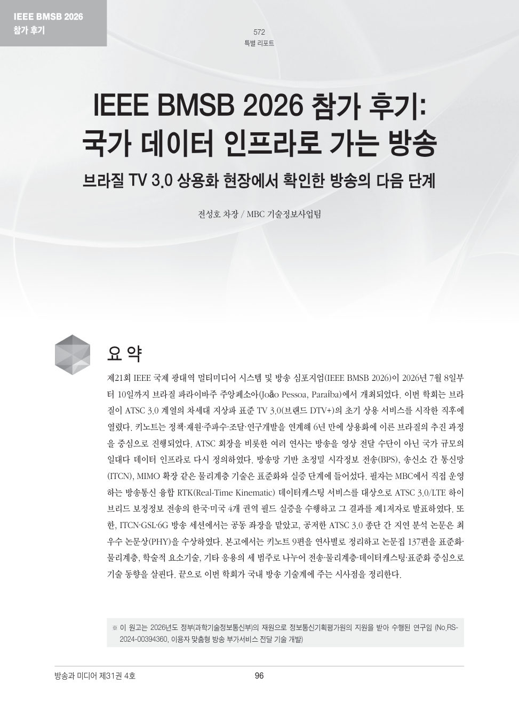

[알림] 본 원고는 한국방송·미디어공학회(KIBME) 학회지 『방송과 미디어』 제31권 4호(2026년 10월 30일 발간)의 '특별 리포트'에 게재되었습니다.

[원고보기 (PDF)](https://www.kibme.org/resources/journal/20261106102353380.pdf)

**□ 개요**

- 게재매체 : 『방송과 미디어』(Broadcast and Media Magazine) 제31권 4호, ISSN 2383-9708
- 발행기관 : 한국방송·미디어공학회(The Korean Institute of Broadcast and Media Engineers, KIBME)
- 발 간 일 : 2026년 10월 30일
- 분    류 : 특별 리포트
- 제    목 : IEEE BMSB 2026 참가 후기: 국가 데이터 인프라로 가는 방송 — 브라질 TV 3.0 상용화 현장에서 확인한 방송의 다음 단계
- 저    자 : 전성호 차장(MBC 기술정보사업팀)
- 쪽    수 : 96–113쪽(통권 572–589쪽)

제31권 4호는 '월드 모델 기반의 차세대 미디어 생성 기술' 특집호로 발간되었으며, 본고는 특별 리포트 3편 가운데 하나로 실렸다. 학회 참가와 최우수 논문상 수상 소식은 [IEEE BMSB 2026 (João Pessoa) — ETRI·MBC·KBS 공동연구팀 최우수 논문상 수상]({{ site.baseurl }}/IEEE_BMSB2026_JoaoPessoa/)에 정리하였다.

**□ 요약**

제21회 IEEE 국제 광대역 멀티미디어 시스템 및 방송 심포지엄(IEEE BMSB 2026)이 2026년 7월 8일부터 10일까지 브라질 파라이바주 주앙페소아(João Pessoa, Paraíba)에서 개최되었다. 이번 학회는 브라질이 ATSC 3.0 계열의 차세대 지상파 표준 TV 3.0(브랜드 DTV+)의 초기 상용 서비스를 시작한 직후에 열렸다. 키노트는 정책·재원·주파수·조달·연구개발을 연계해 6년 만에 상용화에 이른 브라질의 추진 과정을 중심으로 진행되었다. ATSC 회장을 비롯한 여러 연사는 방송을 영상 전달 수단이 아닌 국가 규모의 일대다 데이터 인프라로 다시 정의하였다. 방송망 기반 초정밀 시각정보 전송(BPS), 송신소 간 통신망(ITCN), MIMO 확장 같은 물리계층 기술은 표준화와 실증 단계에 들어섰다. 필자는 MBC에서 직접 운영하는 방송통신 융합 RTK(Real-Time Kinematic) 데이터캐스팅 서비스를 대상으로 ATSC 3.0/LTE 하이브리드 보정정보 전송의 한국·미국 4개 권역 필드 실증을 수행하고 그 결과를 제1저자로 발표하였다. 또한, ITCN·GSL·6G 방송 세션에서는 공동 좌장을 맡았고, 공저한 ATSC 3.0 종단 간 지연 분석 논문은 최우수 논문상(PHY)을 수상하였다. 본고에서는 키노트 9편을 연사별로 정리하고 논문집 137편을 표준화·물리계층, 학술적 요소기술, 기타 응용의 세 범주로 나누어 전송·물리계층·데이터캐스팅·표준화 중심으로 기술 동향을 살핀다. 끝으로 이번 학회가 국내 방송 기술계에 주는 시사점을 정리한다.

**□ 구성**

- 머리말
- BMSB 2026 주요 내용
  - 1. 학술대회 개요
  - 2. 키노트
  - 3. 발표 논문의 분류와 기술 동향 — (1) MIMO·LDM 확장과 브라질 실증, (2) B2X 부트스트랩과 IoT 단말, (3) BPS와 시각동기, (4) ITCN·GSL·SFN, (5) 데이터캐스팅·RTK와 종단 간 지연, (6) TV 3.0 전송·시그널링·애플리케이션 플랫폼
  - 4. 패널토론(Future Developments in Media Technology)
  - 5. 한국 참가진의 성과
- 맺음말

<small>※ 이 원고는 2026년도 정부(과학기술정보통신부)의 재원으로 정보통신기획평가원의 지원을 받아 수행된 연구임 (No.RS-2024-00394360, 이용자 맞춤형 방송 부가서비스 전달 기술 개발)</small>
